# HRMS Payroll Suite — Application Flow

> Generated from a read-only source audit of the repository on 2026-10-09 (HEAD `8d44c5a`).
> Every statement below is traced to source (`file:line`) or to a live query against the running
> stack (http://localhost:8069, DB `hrpay`). Nothing here is aspirational: where a capability is
> declared but not wired, it is marked **Declared / not wired**. Where a screen does not exist it
> is marked **Backend-only**.
>
> This document covers the *product* as currently built. It separates **what the UI exposes** from
> **what the engine can do**, because much of the statutory/audit machinery is reachable today only
> through the ORM/shell, not through any menu.

---

## 1. How to run the stack

| Action | Command (from `C:\Users\hsing`) |
|---|---|
| Start | `wsl -d Ubuntu -u root -- bash -lc "cd /root/hrpay && make up"` |
| Stop | `wsl -d Ubuntu -u root -- bash -lc "cd /root/hrpay && make down"` |
| Status | `make ps` (containers `hrpay-odoo`, `hrpay-postgres`) |
| Logs | `make logs` |
| Odoo shell | `make odoo-shell` |
| Postgres | `make psql` |

- URL **http://localhost:8069** — database **`hrpay`**, login **`admin` / `admin`** (master/DB password also `admin`).
- Health at audit time: both containers `Up (healthy)`, `/web/login` → HTTP `200`.

---

## 2. Module map, dependencies and build status

Dependency edges are from each `__manifest__.py`; the OCA/payroll base addons are installed from the lockfile.

```
hrms_core_ext  (HRMS Core Extension)
├── hrms_statutory   (Statutory Rules Engine)
│      depends: hrms_core_ext, hr_payroll_community, hr_payroll_account_community
├── hrms_roster      (Rostering + Solver)
│      depends: hrms_core_ext, hr_contract
├── hrms_fnf         (Full & Final Settlement)
│      depends: hrms_core_ext, hrms_statutory, hrms_roster, hr_payroll_community, hr_payroll_account_community
├── hrms_payroll_run (Payroll Run lifecycle)
│      depends: hrms_core_ext, hrms_statutory, hrms_roster, hr_payroll_community, hr_payroll_account_community
└── hrms_helpdesk    (HR Service Desk overlay)
       depends: helpdesk_mgmt, helpdesk_type, hrms_core_ext, hrms_statutory
```

### Maturity status (audited, not claimed)

| Module | Backend engine | Screens / menu | Status summary |
|---|---|---|---|
| `hrms_core_ext` | Audit log, encrypted PII, payroll-period lock, integration-sync state | **None** (no `views/`) | **Backend-only.** No menu/list/form for Audit Log, Payroll Period Lock, Integration Sync, or encrypted PII. |
| `hrms_statutory` | Rule catalog, versions, legal basis, wage composition, India PF/ESI/PT/LWF/TDS, gratuity, sign-off gate | **None** (no `views/`) | **Backend-only.** 50 rules + all statutory config reachable only via ORM/shell. Single biggest UI gap. |
| `hrms_roster` | Solver complete but invoked only programmatically; periods/shifts/demand/assignments modelled | **YES** (Rostering menu) | **Mostly wired.** Solver has **no button**. Assignments are `create="false"`. |
| `hrms_fnf` | Settlement engine + arithmetic complete | **YES** (Final Settlements menu) | **Mostly wired.** Rationale lines folded into JSON, not a table. Reasons have no screen. |
| `hrms_helpdesk` | Ticket overrides complete | **YES** (inherits OCA helpdesk) | **Wired via inheritance.** Categories seeded. |
| `hrms_payroll_run` | Run lifecycle complete | **YES** (Payroll Runs menu) | **Wired.** Lifecycle buttons present. |

---

## 3. Security model (who can do what)

Groups are defined once in `hrms_core_ext/security/hrms_security.xml` and reused everywhere.

| Group | Implied | Purpose |
|---|---|---|
| `group_hrms_payroll_admin` | `hr.group_hr_user` | Prepare/run payroll (`hrms_security.xml:13-17`) |
| `group_hrms_finance_approver` | `account.group_account_invoice` | Second pair of eyes: approve/lock runs, pay F&F (`:19-23`) |
| `group_hrms_roster_manager` | — | Roster managers (`:25-28`) |
| `group_hrms_auditor` | — | Read-only everywhere (ACLs on run, results, snapshots) |
| `group_hrms_statutory_admin` | `group_hrms_payroll_admin` | Maintain statutory rules + sign off versions (`:31`) |
| `group_hrms_roster_solver_manager` / `_user` | manager > user | Roster solver propose/manage (`hrms_roster/security/solver_security.xml`) |
| `group_hrms_helpdesk_agent` | `base.group_user` | HR service-desk agents |
| `group_hrms_confidential_case_handler` | — | Confidential ticket handlers |

Two cross-cutting controls:

1. **Segregation of duties** — enforced in Python for run compute/review/approve, F&F approve,
   overtime approve, statutory sign-off, and safety-flag review. A user cannot approve their own work.
2. **Append-only audit** — `hrms.audit.log` records cannot be edited or deleted.

---

## 4. Core data model

| Concern | Model | Source |
|---|---|---|
| Employee / PII | `hr.employee` + `hrms.mixin.encrypted` | `hrms_core_ext/models/hr_employee.py` |
| Audit log | `hrms.audit.log` | `hrms_core_ext/models/hr_core_ext.py` |
| Payroll period lock | `hrms.payroll.period.lock` | `hrms_core_ext/models/payroll_period.py:13` |
| Roster period | `hr.roster.period` | `hrms_roster/models/roster_period.py:26` |
| Statutory rule + version | `hrms.statutory.rule`, `…version` | `hrms_statutory/models/rule.py:47`, `:246` |
| F&F case | `hrms.fnf.case` | `hrms_fnf/models/settlement.py:90` |
| Payroll run | `hrms.payroll.run` | `hrms_payroll_run/models/run.py:41` |

---

## 4a. End-to-end lifecycle

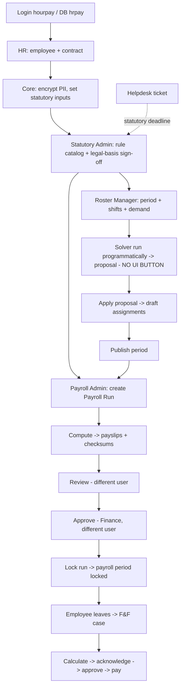

---

## 5. Logon & landing experience

1. `GET /web/login` renders the standard Odoo login (`hrpay` DB). Odoo owns auth; the suite adds **no** custom login, SSO, or MFA.
2. There is **no dedicated HRMS dashboard**. Each module contributes a menu under native apps:
   - **Rostering** — `hrms_roster` (menu root under `hr.menu_hr_root`)
   - **Final Settlements** — `hrms_fnf` (under Payroll)
   - **Payroll Runs** — `hrms_payroll_run` (under Payroll)
   - **Helpdesk** — `hrms_helpdesk` overlays OCA `helpdesk_mgmt`
   - **Audit Log / Payroll Period Lock / Integration Sync / Statutory Rules** — **no menu** (backend-only, §20).

**Live data reality:** 50 statutory rules, **0 rule versions**, **0 legal bases** signed off. So compute is gated: a run that reaches compute with employees but no signed-off basis fails the sign-off gate (`_snapshot` raises → `_coverage_gaps` → `blocking_issues` → `action_compute` raises `UserError`).

---

## 5a. Login and access flow

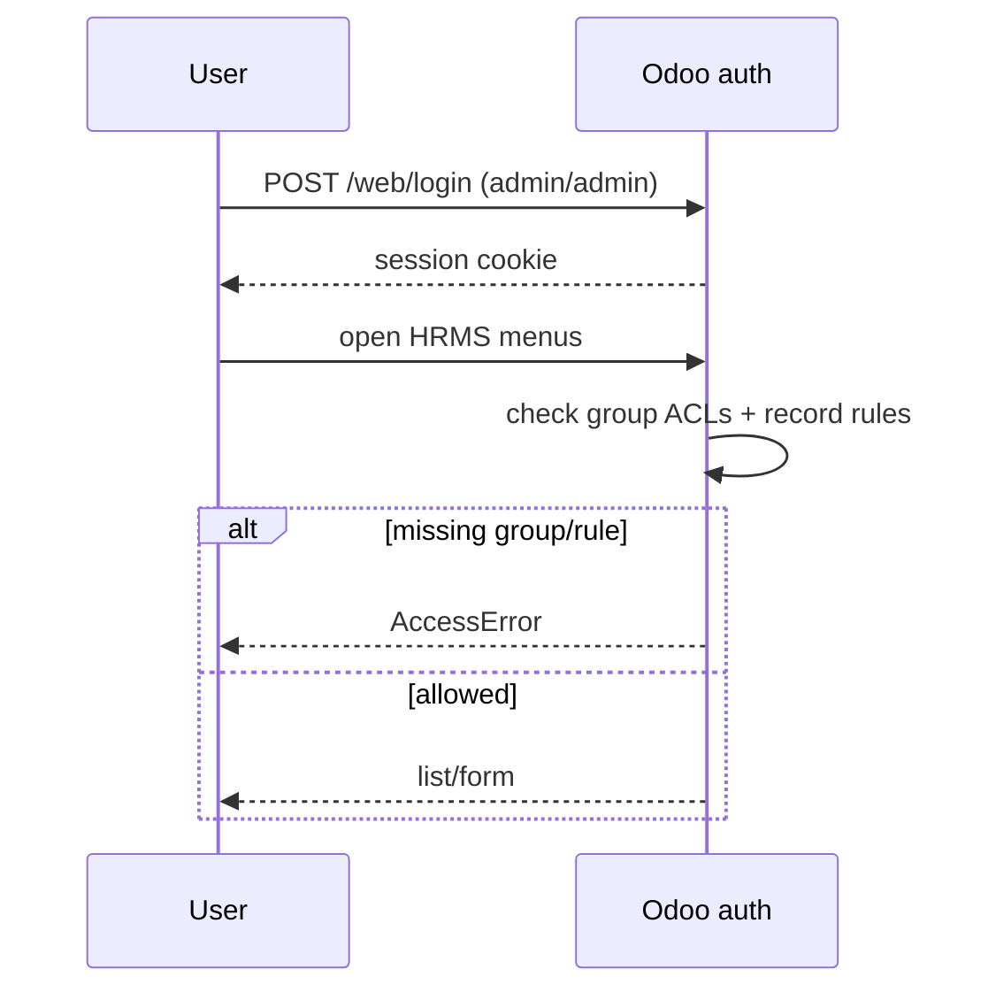

Status: standard Odoo; the HRMS suite adds groups and record rules but no custom auth.

---

## 5b. Roles and the "separation of duties" matrix

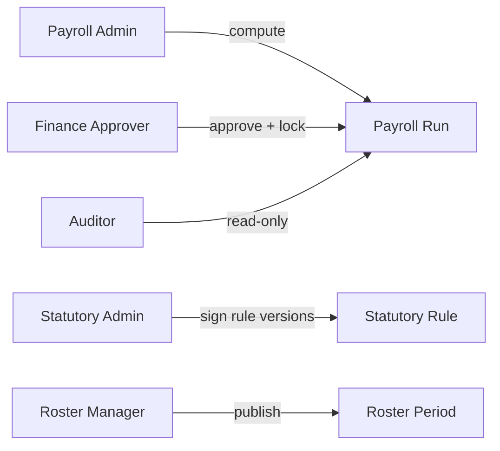

| Action | Payroll Admin | Finance Approver | Auditor | Statutory Admin |
|---|---|---|---|---|
| Compute run | yes | yes | no | no |
| Approve/lock run | no (must differ from computer) | yes | no | no |
| Sign rule version | no | no | no | yes |
| Pay F&F | no | yes | no | no |

---

## 6. Employee & payroll master data (hrms_core_ext)

**Backend-only** — adds fields/models, no views.

- **Encrypted PII** (`models/hr_employee.py`): six fields encrypted at rest via `hrms.mixin.encrypted`;
  masked `*_display` computed fields; revealing calls `_hrms_reveal()` which writes an audit row
  first, then returns plaintext. No UI.
- **Statutory inputs**: `hrms_state_code`, `contract_type`, `hrms_contract_start/end`,
  `hrms_tax_regime`, `hrms_ctc`, `hrms_tds_deduction`, `hrms_ytd_taxable`, `hrms_tds_ytd`,
  `hrms_pf_eps_ytd` (required for annual PF ceiling).
- **Integration sync** (`models/hr_core_ext.py`): canonical payload hash; `action_recompute_sync_hash`,
  `action_mark_synced`, `action_mark_failed`. External system owns the actual sync.
- **Payroll period lock** (`models/payroll_period.py`): `draft→locked` with conflict checks and audit;
  no view.

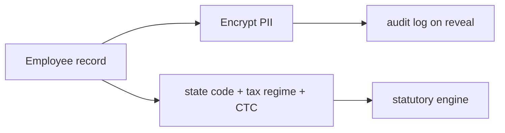

Status: **Backend-only** (works, drives from shell/API).

---

## 7. Statutory rules engine (hrms_statutory)

**Backend-only. No views.**

- **Rule catalog** (`models/rule.py`): header rule + `version` holding the value with a **sign-off
  gate** — cannot activate a version unless `validated_by` is set and differs from the author.
- **Legal basis**: jurisdiction + effective date; must be signed off before use.
- **Wage composition** (`models/wages.py`): maps contract wage components to each statutory base.
- **India engine** (`models/india.py`): PF/ESI/PT/LWF/TDS + gratuity; writes `hrms.india.statutory.result`.

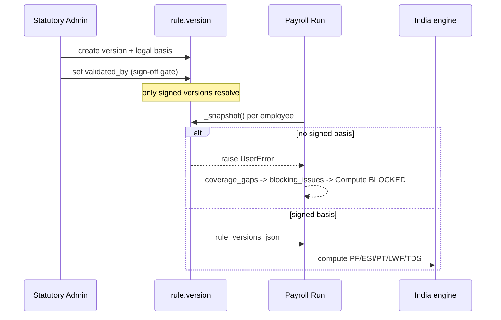

Status: **Backend-only.** Catalog seeded on install with **placeholder** values, **0 activated versions**.

---

## 8. Rostering & solver (hrms_roster)

**Wired UI: YES.** Menu **Rostering** → Roster Periods, Shifts, Demand, Assignments, Solver Settings,
Availability, Solver Results.

- `hr.roster.period` (`roster_period.py:26`): `draft → published → locked`; publish requires all
  assignments non-draft, no unpaid shifts, no negative overtime. **Unlock is intentionally blocked.**
- `hr.roster.assignment` (`roster_assignment.py:29`): `draft, confirmed, published, relieved,
  cancelled`; only `action_confirm` (draft→confirmed) is UI-wired. `relieved`/`cancelled` **Declared / not wired**.
- `hr.roster.demand` (`roster_assignment.py:314`): per establishment/weekday/shift headcount + skills.
- `hrms.roster.solver.setting` (`solver.py:40`): hard limits + `unresolved_demand_strategy`.

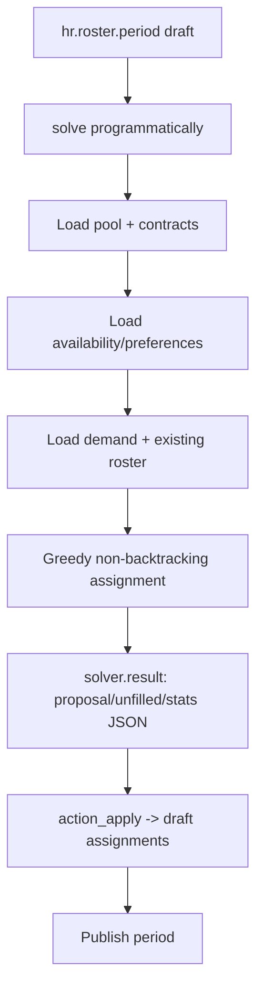

- Entry point `hrms.roster.solver.solve(period, setting=None)` (`solver.py:330`) **never writes
  assignments**; it writes a proposal only.
- `action_apply` (`solver.py:264`) turns a proposal into draft assignments.
- **Blocking gap**: the solver is invoked **only from `tests/test_solver.py:122`** — **no button,
  action or cron runs it**. Also `unresolved_demand_strategy` is never read by the solver.

Status: **Wired except the solver trigger.** Rostering works; producing a proposal needs the shell/API.

---

## 9. Payroll Run (hrms_payroll_run)

**Wired UI: YES** — menu **Payroll Runs**.

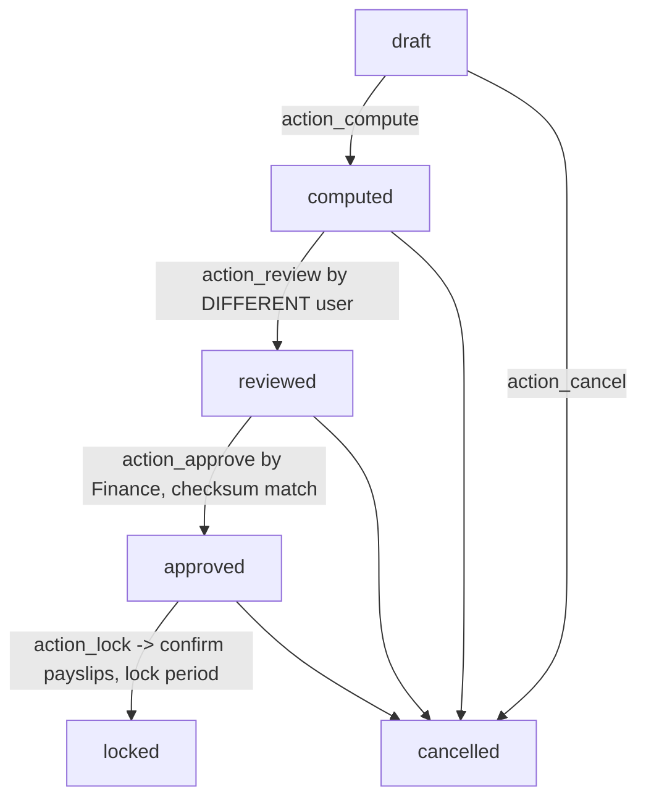

Controls (`models/run.py`):
- `action_compute` (`:318`): refuses if not draft or blocking issues exist.
- `action_review` (`:429`): reviewer must not be the computer; note required if anomalies flagged.
- `action_approve` (`:464`): must differ from computer **and** reviewer; recomputes checksum, refuses drift.
- `action_lock` (`:495`): refuses draft payslips; requires linked payroll period lock; confirms/dones payslips.
- `action_cancel` (`:545`): blocked once locked; reason required if no note/flags.
- `action_record_ai_flags` (`:572`): advisory flags only.

### 9a. Statutory-coupling reality (audited)

| Coupling | Source | Reality |
|---|---|---|
| Run requires roster | `_unrostered_employees` (`run.py:291`) | Gates only on **presence** of assignments; a **draft** roster satisfies it. |
| Roster locks after run | `hr.roster.period.action_lock` (`roster_period.py:160`) | Order is reversed: roster locks only after the run reaches `locked` (`run.py:527`). |
| Statutory signed before compute | `_coverage_gaps` via `_snapshot` (`rule.py:537`) | Enforced; compute raises without a signed basis. |
| Period lock | `models/payroll_period.py:110` | Run refuses if period already locked. |

---

## 10. Full & Final Settlement (hrms_fnf)

**Wired UI: YES** — menu **Final Settlements** (under Payroll).

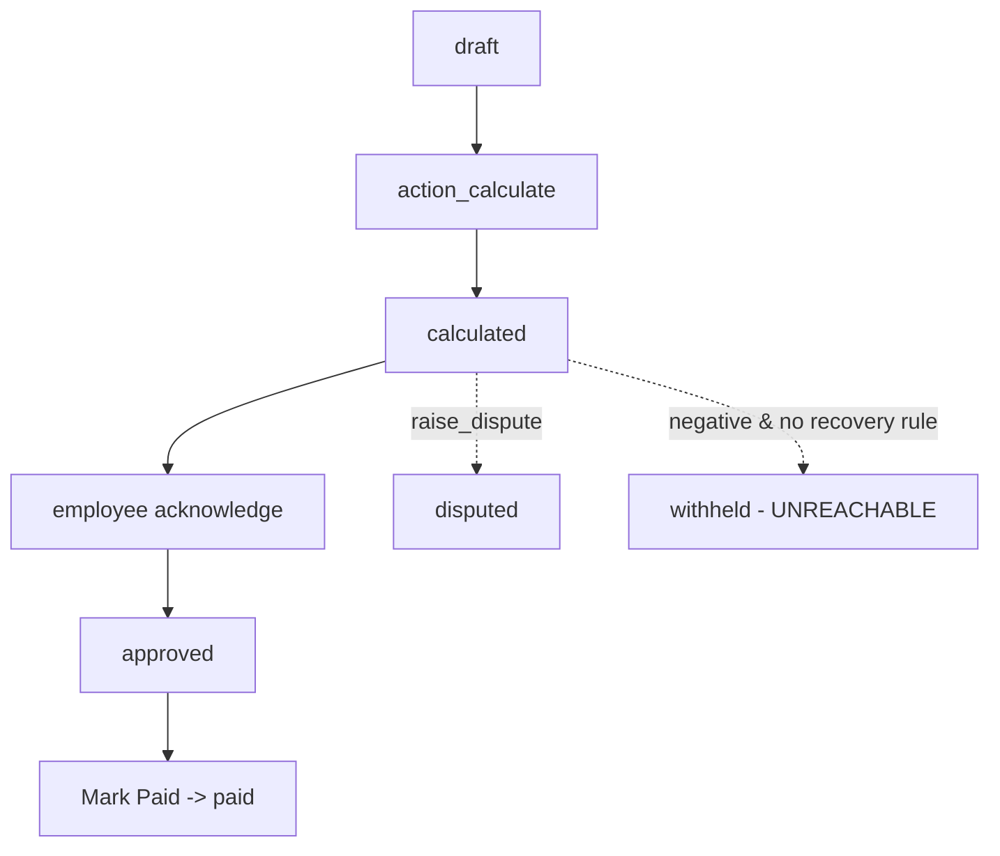

Controls (`settlement.py`):
- `action_calculate` (`:329`): requires mandatory inputs per separation reason; runs pure arithmetic;
  writes result checksum + audit.
- `action_approve` (`:390`): refused for the calculating user; negative settlements require the
  reason to permit recovery.
- `action_mark_paid` (`:412`): only finance approvers (button `groups=` + ACL).
- `action_raise_dispute` (`:425`): requires a reason.

The statement lines (`hrms.fnf.line`, `encashment.py:20`) are built from the reason's statutory codes,
but the **UI shows the case, not the line table** (lines are folded into JSON/checksum). No view for
`hr(n)ms.fnf.line` or reasons.

Status: **Mostly wired.**

---

## 11. Helpdesk (hrms_helpdesk) — inherits OCA `helpdesk_mgmt`

- `helpdesk.ticket.type` override adds `hrms_statutory_code`, `hrms_confidential_by_default`,
  `hrms_statutory_retention_months`, `hrms_employee_required`.
- `helpdesk.ticket` override adds confidential flag, statutory deadline/breach, AI-triage fields,
  `action_confidential`, `action_review_ai_triage`, `action_reopen_with_note`.
- 8 seeded categories map to statutory codes (grievance, POSH, PF, ESI, F&F, attendance, payslip, LWF).
- Views inherit the OCA form/search; **no new menu**.

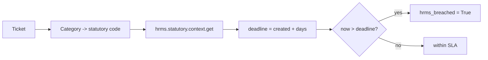

Status: **Wired via inheritance.** "AI" is a record-and-review surface only.

---

## 12. Settings surface

| Config | Where | UI |
|---|---|---|
| Groups/category | `hrms_core_ext` security | Users & Companies |
| Statutory rules / legal basis | `hrms_statutory` models | **none** |
| Solver limits | `hrms.roster.solver.setting` | Rostering → Solver Settings |
| F&F separation reasons | `hrms_fnf.reason` | **none** (seeded) |
| Helpdesk categories | `helpdesk.ticket.type` | Helpdesk (OCA) |

No consolidated HRMS settings screen; the two most important config surfaces have no UI.

---

## 12a. Configuration flow (who changes what)

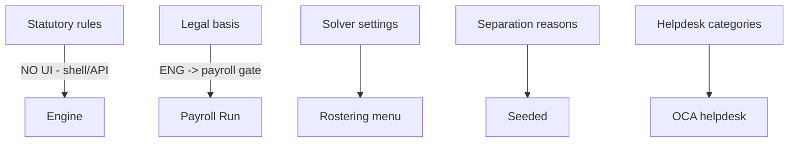

---

## 13. Audit & reporting

- **Audit log** (`hrms.audit.log`): append-only; `_sensitive_fragments` redaction. **No menu / no report.**
- **Rule versions** captured per run (`rule_versions_json`) so a run can be replayed against the
  exact statutory version set.
- **Reports**: no QWeb/PDF reports are defined by any module.

---

## 14. AI anomaly layer

Fields exist on `hrms.payroll.run` (`ai_flags_*`) and `hrms_helpdesk` (`hrms_ai_*`). The **producer
is not in this repo** — flags are recorded/reviewed from outside. Status: **integration point only.**

---

## 15. Notifications, cron, mail, integrations

- No `ir.cron` defined by any HRMS module.
- No mail templates defined by the HRMS modules.
- National/State/Provident integration is **not implemented**; only integration-facing fields exist.
- **No HTTP/JSON controllers** in any HRMS module (see §20).

---

## 16. Error, permission and concurrency handling

- Permission failures surface as native `AccessError` (ACLs/record rules/Python gates).
- Business rules raise `UserError` with messages (see source citations).
- Concurrency: state machines guard transitions by `state`; the run checksum detects post-approval
  drift. No custom optimistic locking.

---

## 17. Data retention

Helpdesk seeds retention months per category; statutory has a retention concept in config. No
scheduled purge is wired.

---

## 18. The clickable happy path (honest scope)

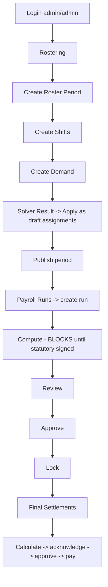

The **dead-end at Compute** is real: without a signed legal basis + rule versions, a run cannot
compute, and there is no UI to sign one off.

---

## 19. Known gaps and defects (source-traced)

| # | Finding | Impact | Source |
|---|---|---|---|
| G1 | ~~Statutory module has no views~~ **RESOLVED** | `hrms_statutory/views/statutory_views.xml` adds rules/versions/legal-basis screens with a sign-off button | now has `views/` |
| G2 | ~~Core-extension has no views~~ **RESOLVED** | `hrms_core_ext/views/core_ext_views.xml` adds period locks, audit log, sync log, and an employee "HR Security" page | now has `views/` |
| G3 | Solver has no UI action | Rostering needs shell to produce a proposal | `hrms_roster/views/solver_views.xml` |
| G4 | `unresolved_demand_strategy` never read | `raise_anomaly` behaves like `report` | `hrms_roster/models/solver.py` |
| G5 | F&F `withheld` state unreachable | Dead designed state | `hrms_fnf/models/settlement.py` |
| G6 | Two near-identical negative-settlement record rules | One likely never applies | `hrms_fnf/security/hrms_fnf_security.xml:12` and `:40` |
| G7 | Roster `relieved`/`cancelled` have no transition method | Dead states | `hrms_roster/models/roster_assignment.py:78-79` |
| G8 | Run roster gate uses any assignment state | A draft roster satisfies it | `hrms_payroll_run/models/run.py:291-307` |
| G9 | `actual_hours` never populated by code | Overtime/attendance path manual | `hrms_roster/models/roster_assignment.py:86` |
| G10 | `_compute_deviation` reads non-existent `shift_start_datetime`/`shift_end_datetime` | Runtime AttributeError on check-in | `hrms_core_ext/models/hr_core_ext.py:112-113` |
| G11 | No AI model in-repo | "AI" is record/review only | `ai_flags_*`, `hrms_ai_*` |
| G12 | No reports (QWeb/PDF) | No custom payslip/settlement output | no report actions |

---

## 20. Platform / integration notes

- **Odoo** 18.0 (manifest versions `18.0.x`). **DB** PostgreSQL. **Cache** Odoo defaults.
- **Storage** local Odoo filestore. **Cache/none beyond defaults.**
- **Integration**: external sync only via the integration-facing fields in `hrms_core_ext`; no endpoint in-repo.
- No HTTP/JSON controllers in any HRMS addon; the API surface is Odoo ORM/RPC (see §21).

---

## 20a. API surface (Odoo RPC only)

There are **no HTTP controllers** in any HRMS module. The "API" is Odoo's JSON-RPC/XML-RPC
(`/web/dataset/call_kw`, `/jsonrpc`) over the models and methods inventoried in
`docs/api-inventory.md`. See §21 and `docs/api-test-plan.md` / `api-test-results.md`.

---

## 20b. Platform notes

- Odoo 18.0, PostgreSQL, local filestore.
- Statutory values sourced through `hrms.statutory.context`; no in-code rate literals.
- `hrms_core_ext` requires the `python3-cryptography`-provided AES primitives for encrypted PII.

---

## 21. Test / verification entry points

| Layer | What | Where |
|---|---|---|
| Pure arithmetic | PF/ESI/PT, gratuity, TDS, F&F, solver; no Odoo | `tests/` (`make test`) |
| Odoo integration | 105 tests across all addons | `tests/` (`make test-odoo`) |
| Manual UAT | Story-by-story script | `docs/manual-uat-stories.md` |

---

*End of application flow.*
